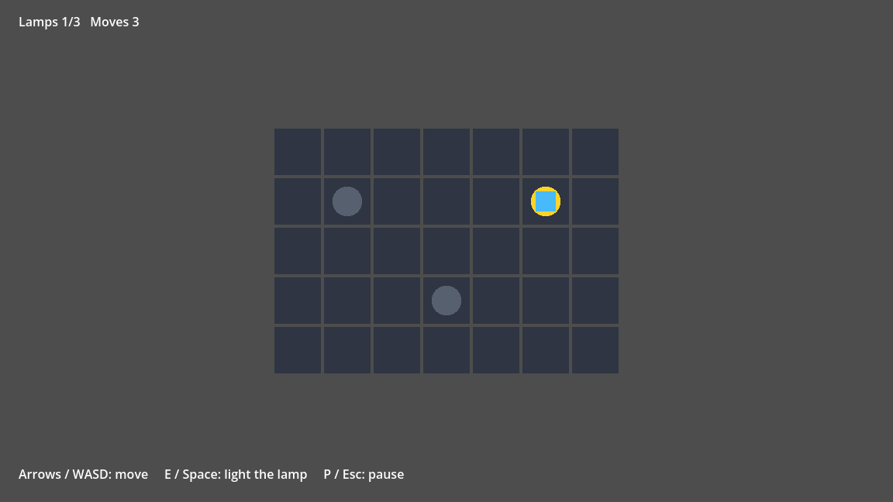

# Godot Goblin Gearbox

A Godot 4.7 project template for working with coding agents: one command that checks
everything, and a way for the agent to drive the running game and look at it.

GDScript. Windows and Linux. PowerShell 7, Python 3.12 through uv. MIT. Start a game from
it, or install it into one you have.



```sh
pwsh ./tools/check.ps1
uv run python tools/devtools.py input sequence test/sequences/smoke.json
uv run python tools/devtools.py screenshot --filename smoke.png
```

After [Start](#start). The last two need the game running: they play a sequence of inputs
with its asserts and take the picture above. The first:

```text
Gate           Result   Seconds  Detail
----           ------   -------  ------
ascii          pass         0.6  ASCII guard: CLEAN (16 PowerShell script(s))
gdlint         pass         2.7  GDScript lint + format: CLEAN
typecheck      pass         5.0  Type-check: CLEAN (22 of 22 files)
project-lint   pass         0.4  LINT_PROJECT_OK errors=0 warnings=0
shader-lint    skipped        -  no .gdshader files
validate-all   pass         0.8  VALIDATE_ALL_OK loaded=21
scenes         pass         0.3  DevTools: Scenes valid: 1 checked, 0 errors, 0 warnings
test-lint      pass         0.6  Test lint: CLEAN (2 file(s))
ruff           pass         0.1  All checks passed!
pytest         skipped        -  tools/tests not present
architecture   pass         0.2  architecture: ok
typed-ternary  pass         0.1  typed ternaries: ok (22 files)
wall-clock     pass         0.1  wall clock: ok (2 test scripts, 22 scripts in all)
agents-md      pass         0.1  agents-md: ok (AGENTS.md: 159 lines, 8,519 bytes)
tests          pass         3.5  Tests: PASSED. 15 test cases | 0 errors | 0 failures | 0 flaky | 0 skipped | 0 orphans

check: PASSED: 13 passed, 0 failed, 2 skipped in 15.1s
```

That is a new game. The kit's own tests, more than 1,300 for its tools and its addon, add
about three and a half minutes while they are in the project.

A failure names the file, the line and the reason:

```text
typecheck      FAIL         4.6  exit 1: Type-check FAILED: 1 file(s) violate the strict GDScript warnings.

  FAIL  res://scripts/core/board.gd
        Parse Error: Variable "twice" has no static type. (Warning treated as error.) (res://scripts/core/board.gd:62)
```

## What you get

| | |
|---|---|
| **One check** | `tools/check.ps1`: format and lint, the engine's strict type check, uid, scene and shader lint, load every resource, instantiate every scene, test lint, a layering check, gdUnit4. Last line `check: PASSED` or `check: FAILED`; a non-zero exit on any failure. |
| **Eyes and hands** | The `DevTools` autoload and `tools/devtools.py`: screenshot, scene tree, node state, performance, input, sequences with asserts, your own commands. Plain files and a CLI: no server to run. |
| **Fast tests** | `tools/test_shards.py`: gdUnit4 in parallel processes, by default only the suites your diff can affect. A machine-wide slot pool lets several agents share one machine. |
| **Strict GDScript** | Untyped declarations, unsafe access, integer division, shadowing and unused code are errors, in the editor and from `tools/typecheck.ps1`. |
| **Agent instructions** | `AGENTS.md`, about 160 lines: your project on top, the kit's workflow, commands and verified traps below. `CLAUDE.md` imports it. A lint keeps it short and its paths real. |
| **A quality bar** | Starting rules for how the game moves and what may ship: the twelve principles of animation and juice ([docs/feel.md](docs/feel.md)), making and reviewing assets ([docs/assets.md](docs/assets.md)), read-only critics who hunt for what is broken, unclear or dull ([docs/critique.md](docs/critique.md)). |
| **Setup** | `tools/setup.ps1 -InstallGodot` fetches the pinned Godot and checks its SHA-512. gdUnit4 is vendored. `tools/doctor.ps1` names what is missing and the command that fixes it. |
| **CI** | `.github/workflows/ci.yml` runs the same check on Ubuntu and Windows. |

## Start

| Needs | Windows | Linux |
|---|---|---|
| PowerShell 7 | 7.0 or newer: `winget install Microsoft.PowerShell` | 7.2 or newer: [install](https://learn.microsoft.com/powershell/scripting/install/installing-powershell-on-linux) |
| [uv](https://docs.astral.sh/uv/) | `winget install astral-sh.uv` | [install](https://docs.astral.sh/uv/getting-started/installation/) |
| git | `winget install Git.Git` | `apt install git`, `dnf install git` |

Godot and Python come through the setup command. Every command of the kit starts with `pwsh`
or `uv`: type it the same in pwsh and in bash.

- macOS, not run: [docs/platforms.md](docs/platforms.md#prerequisites).
- Linux without a display (ssh, a container)? The check needs none. The game runs under
  Xvfb: [the packages](docs/platforms.md#prerequisites).
- Downloaded as a zip on Windows? Windows blocks the scripts until you run, in pwsh in that
  folder, `Get-ChildItem -Recurse -Filter *.ps1 | Unblock-File`. A git clone needs nothing.

**A new game.** Create a repository from this template (GitHub: *Use this template*), clone
it, then name the game, set up and check:

```sh
pwsh ./tools/new_game.ps1 -Title "My Game" -Blurb "One line about it." -RemoveKitTests
pwsh ./tools/setup.ps1 -InstallGodot
pwsh ./tools/check.ps1
```

**An existing game**, on Godot 4.7. Commit it first: without git there is no undo. Clone the
kit beside it. From the kit's folder, `-DryRun` prints the plan and writes nothing:

```sh
pwsh ./install.ps1 -Target ../my-game -DryRun
pwsh ./install.ps1 -Target ../my-game
```

Then, in your project:

```sh
pwsh ./tools/setup.ps1 -InstallGodot
pwsh ./tools/check.ps1
```

The installer copies `tools/` and `addons/agent_devtools/`, adds gdUnit4 when you have none,
and edits `project.godot` as text: the `DevTools` autoload, the two editor plugins,
`devtools/allow_mutation=false`. Where you have no such file it writes starter files:
`kit.json`, `AGENTS.md`, `CLAUDE.md`, `docs/`, lint and Python config, a CI workflow. It never
overwrites a file of yours: an `AGENTS.md` you have is kept, and the kit's lands beside it as
`AGENTS.kit.md`. A run that is killed leaves every file whole; run it again and it finishes.

The first check reports what your code does not pass yet, each finding with its fix.
`pwsh ./tools/check.ps1 -Fix` formats your scripts. The strict type gate starts off;
`-StrictWarnings` turns it on. Every rule, note and refusal of the installer:
[docs/tools.md](docs/tools.md#installps1).

## The loop

While working. `-Changed`: the gates, and tests for the suites the diff can affect. `-Fix`:
format in place, then check.

```sh
pwsh ./tools/check.ps1 -Changed
pwsh ./tools/check.ps1 -Fix
pwsh ./tools/lint_gdscript.ps1 -Path scripts/core/board.gd
pwsh ./tools/typecheck.ps1 -Path scripts/core
uv run python tools/test_shards.py test/unit/test_board.gd
```

The editor: `pwsh ./tools/godot.ps1 -e`.

Seeing and driving the game. Start it in the background under a name of your own, one per
running game. Windows, in pwsh:

```powershell
$env:GODOT_AGENT_SESSION = "agent-1"
Start-Process pwsh "-NoProfile -File tools/godot.ps1"
```

Linux, in bash (macOS: the same lines, not run). Without a display, put `xvfb-run -a` in
front of `pwsh`:

```bash
export GODOT_AGENT_SESSION=agent-1
mkdir -p artifacts
pwsh ./tools/godot.ps1 > artifacts/game.log 2>&1 < /dev/null &
```

Then, on every system:

```sh
uv run python tools/devtools.py wait
uv run python tools/devtools.py input sequence test/sequences/smoke.json
uv run python tools/devtools.py screenshot --filename smoke.png
uv run python tools/devtools.py performance
uv run python tools/devtools.py input clear
uv run python tools/devtools.py quit
```

`screenshot` prints the path of the file it wrote. A game that does not quit, and the launch
in pwsh on Linux: [docs/devtools.md](docs/devtools.md).

A sequence is JSON steps: press, release, tap, hold, wait, assert, screenshot, clear, call
([fields](docs/devtools.md#sequences)). The sample, shortened:

```json
{
  "steps": [
    {"type": "call", "action": "reset"},
    {"type": "tap", "action": "move_right"},
    {"type": "tap", "action": "move_right"},
    {"type": "tap", "action": "move_up"},
    {"type": "assert", "node": ".", "property": "player_cell", "equals": {"x": 5, "y": 1}},
    {"type": "tap", "action": "interact"},
    {"type": "assert", "node": ".", "property": "lit_count", "equals": 1},
    {"type": "screenshot", "filename": "smoke.png"}
  ]
}
```

A failed assert exits 1 with one line. From a three-step sequence:
`Failed: Sequence a5164a2d failed at step 1 of 3 (counted from 0): Assertion failed: .:lit_count is 0, expected 5`.

Reference: [docs/tools.md](docs/tools.md), [docs/devtools.md](docs/devtools.md),
[docs/gotchas.md](docs/gotchas.md), [docs/platforms.md](docs/platforms.md).

## Make it yours

A game made from the template: every line. A game the kit was installed into: the
`AGENTS.md`, `kit.json`, CI and `docs/` lines.

- [ ] Name it with `tools/new_game.ps1`, as in Start. `-RemoveKitTests` deletes the kit's own
      tests (`tools/tests/`, `test/kit/`).
- [ ] Edit the sections of `AGENTS.md` marked `(sample)`; read the ones marked `(default)`.
      Guide: [docs/customizing-agents-md.md](docs/customizing-agents-md.md).
- [ ] Replace the sample game: `main.tscn`, `scripts/`, `test/unit/`, `test/sequences/`, its
      actions under `[input]` in `project.godot`. The full list is in the guide, section 3.
- [ ] Set `kit.json`, the one configuration file: folders that are not your code, where tests
      live, the Godot pin. No folder layout is assumed. [Keys](docs/tools.md#kitjson).
- [ ] Make `tools/ci/architecture_modules.json` match your folders, or delete it:
      [docs/architecture.md](docs/architecture.md).
- [ ] CI runs on two systems. Building for one? Delete the other from `matrix.os` in
      `.github/workflows/ci.yml`.
- [ ] Write your own `README.md`. Delete `CHANGELOG.md`, `SECURITY.md`, `CONTRIBUTING.md`,
      `install.ps1` and `docs/images/`. Keep `VERSION`: the first upgrade asks for it.
- [ ] Put your game's licence in `LICENSE`. The kit's notice stays in `tools/LICENSE` and
      `addons/agent_devtools/LICENSE`.
- [ ] Leave the pages in `docs/` as shipped, except `docs/provenance.md`, which is yours: an
      upgrade keeps them current only while you have not changed them.

## Update and remove

Clone the kit, or pull your clone, then run its installer on your game again, `-DryRun`
first. Kit files are updated; one you edited is a conflict, and nothing is written. Starter
files you left alone are updated, the ones you changed are kept. `AGENTS.md` and `kit.json`
are never touched. `tools/kit_manifest.json` is how the installer tells its files from yours:
commit it. A game made from the template has none yet, and takes
[one more step](docs/customizing-agents-md.md#kit-updates-and-agentskitmd) before its first
update.

There is no uninstaller. If the install is one commit, revert it. Otherwise the manifest
lists what to undo: [docs/tools.md](docs/tools.md#removing-the-kit).

## Compatibility

| | |
|---|---|
| Godot 4.7, standard build (4.7.2 pinned) | Yes. Everything is run on it |
| Godot 4.6 and older | No. The tools refuse a Godot that is not 4.7 |
| C#, the Mono build | No. The tools skip a Mono build and check no C# |
| Windows 11 x86_64, PowerShell 7.0 or newer | Yes. Everything is run on it, under PowerShell 7.6 |
| Linux x86_64, PowerShell 7.2 or newer | Yes. Everything is run on Ubuntu 24.04 under PowerShell 7.6, the game under Xvfb |
| Linux arm64, macOS | Written and unit-tested, never run: [docs/platforms.md](docs/platforms.md) |
| Windows 10 | Untested |
| gdUnit4 | 6.2.2, vendored unmodified, pinned by hash |
| gdtoolkit (gdlint, gdformat) | 4.5.0 |

## Works with

Any agent that reads `AGENTS.md` and can run a shell command: Codex, Cursor, Claude Code and
others. `.github/copilot-instructions.md` points GitHub Copilot at it.

Extras for Claude Code: `tools/mcp/server.py` offers the DevTools commands as MCP tools
(optional: copy `tools/mcp/.mcp.json.example` to `.mcp.json`); `.claude/settings.json`
pre-approves the kit's check and DevTools commands, so they run your project's scripts and
tests without a prompt.

## Safety

- `DevTools` runs in debug builds and does nothing in a release build.
- It takes commands from files in the game's user data folder. There is no authentication:
  anything that can write to that folder can drive a running debug game. Do not hand a debug
  build with the addon to people you do not trust.
- `set-state` and `run-method` are refused until `devtools/allow_mutation=true` is set in
  `project.godot`. It ships `false`. With it `true`, whoever can write that folder can call
  any method of any node.
- The Godot download is refused when its SHA-512 does not match `kit.json`. A Godot found
  another way (`GODOT_BIN`, `godot.search_roots`, `PATH`) is run as it is.
- Exporting: put `addons/gdUnit4/*, test/*, tools/*, kit.json` in the preset's exclude filter,
  or the build ships them. `addons/agent_devtools` stays: `project.godot` names its autoload.
- Found a hole? [SECURITY.md](SECURITY.md).

## Limits

- A green check does not show that the game looks right. Someone has to open the screenshot.
- The shader lint parses and type-checks. It does not compile for a GPU.
- The kit checks and drives a game. It does not author scenes in the editor.
- Never run: macOS, Linux arm64, a Linux desktop session (a window manager, a GPU). Wayland
  without X11 failed on two headless compositors: put `xvfb-run -a` in front.
- On GitHub's hosted Windows runner a full check with the kit's own tests took 17 minutes.

## License

MIT: [LICENSE](LICENSE). gdUnit4 is MIT, by Mike Schulze: [THIRD_PARTY.md](THIRD_PARTY.md).
Changes: [CONTRIBUTING.md](CONTRIBUTING.md).
